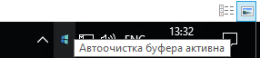
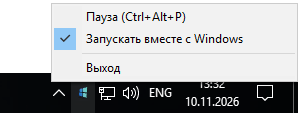
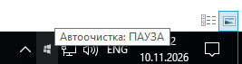

# 🛡️ Buffer Cleaner (Single-Use Clipboard Custodian / Одноразовый буфер обмена)

**Buffer Cleaner** is an ultra-lightweight Windows utility (C++ / WinAPI) designed to automatically wipe sensitive data (passwords, tokens, personal info) from your clipboard. / **Buffer Cleaner** — это ультралегкая утилита для Windows, которая автоматически уничтожает конфиденциальные данные из буфера обмена.

## 🔥 Key Features / Ключевые функции
* **Single-Use Paste / Одноразовая вставка:** Wipes data 300ms after pasting via keyboard or mouse. / Стирает данные через 300 мс после вставки.
* **Self-Destruct Timer / Таймер самоликвидации:** Purges unused data after 1 minute with a notification. / Очищает неиспользованные данные через 1 минуту.
* **Global Pause / Глобальная пауза:** Toggle protection via tray icon or hotkey **`Ctrl + Alt + P`**. / Переключение защиты через трей или клавиши **`Ctrl + Alt + P`**.
* **Instance Guard & Autostart / Защита и автозапуск:** Uses a Mutex to prevent duplicates and supports Windows startup. / Защита от дубликатов через мьютекс и настройка автозапуска.
<p align="center">
  
  
  
</p>

## 🚀 Quick Start / Быстрый старт
1. **Launch:** Run `buffer_cleaner.exe` to quietly minimize to the system tray. / Запустите `buffer_cleaner.exe` для работы в фоне.
2. **Usage:** Copy and paste sensitive text once; the tray icon will flash upon deletion. / Скопируйте и вставьте текст один раз — иконка мигнет при стирании.
3. **Control:** Use the tray context menu or **`Ctrl + Alt + P`** to manage the app. / Используйте меню трея или **`Ctrl + Alt + P`** для управления.

## 🛠️ Build from Source / Сборка проекта
```bash
windres resource.rc -o resource.o
g++ buffer_cleaner.cpp resource.o -o buffer_cleaner.exe -mwindows -luser32 -lshell32 -ladvapi32
```


***************************************************************

🛡️ Buffer Cleaner (Одноразовый буфер обмена)

Buffer Cleaner — это ультралегкая утилита для Windows, которая автоматически уничтожает конфиденциальные данные (пароли, токены, личные данные) из буфера обмена сразу после их использования. Она предотвращает скрытое чтение вашего буфера сторонними программами, сайтами и вредоносным ПО.

🔥 Ключевые функции

• Одноразовая вставка: Текст физически стирается из памяти системы ровно через 300 мс после вставки клавиатурой (Ctrl+V, Shift+Insert) или мышкой через контекстное меню.
• Таймер самоликвидации: Если данные были скопированы, но не использованы в течение 1 минуты, утилита автоматически очистит буфер и пришлет пуш-уведомление.
• Глобальная пауза: Мгновенное включение/выключение режима защиты в один клик по иконке или с помощью системной комбинации клавиш Ctrl + Alt + P.
• Защита от дубликатов: Программа использует системный мьютекс, исключая повторный запуск и появление лишних иконок в трее.
• Автозапуск: Возможность включать запуск утилиты вместе с Windows прямо из меню программы.

🚀 Быстрый старт (Инструкция)

1. Запуск: Запустите buffer_cleaner.exe — программа тихо свернется в системный трей и сразу начнет защиту.
2. Использование: Скопируйте любой конфиденциальный текст. Вставьте его один раз в нужное место (мышкой или клавиатурой) — иконка в трее мигнет, сигнализируя об успешном уничтожении данных из памяти Windows.
3. Управление: Кликните правой кнопкой мыши по иконке в трее для настройки автозапуска или выхода. Используйте Ctrl + Alt + P для быстрой приостановки очистки.

🛠️ Сборка проекта (для разработчиков)

Проект написан на чистом C++ (WinAPI) без тяжелых сторонних библиотек.
Компиляция через g++ (MinGW):

bash

windres resource.rc -o resource.o
g++ buffer_cleaner.cpp resource.o -o buffer_cleaner.exe -mwindows -luser32 -lshell32 -ladvapi32
